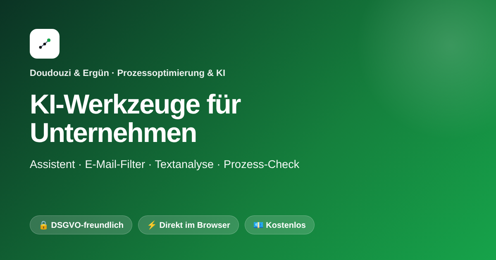
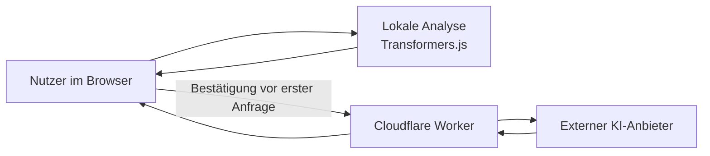

<div align="center">



# KI-Suite für Unternehmen

**Praktische Browser-Tools für E-Mail, Prozesse, Gastronomie, Logistik und Textanalyse.**

<a href="https://enesdoudouzi-sys.github.io/ki-tool/">
  
</a>


</div>

---

## Live ausprobieren

Die Werkzeuge laufen als statische Website. Für einzelne KI-Funktionen ist eine Internetverbindung erforderlich.

| Werkzeug | Demo | Kurzbeschreibung |
|---|---|---|
| E-Mail-Dashboard | [Öffnen](https://enesdoudouzi-sys.github.io/ki-tool/email-dashboard/) | E-Mails sortieren, priorisieren und Antwortentwürfe erstellen |
| E-Mail-Filter | [Öffnen](https://enesdoudouzi-sys.github.io/ki-tool/email-filter/) | E-Mail-Text lokal kategorisieren und Stimmung einschätzen |
| Prozess-Check | [Öffnen](https://enesdoudouzi-sys.github.io/ki-tool/prozess-check/) | Abläufe, Wartezeiten und Verbesserungsmöglichkeiten untersuchen |
| Logistik-KI | [Öffnen](https://enesdoudouzi-sys.github.io/ki-tool/logistik/) | Beispiele und Textarbeit für Logistikprozesse |
| Gastro-Paket | [Öffnen](https://enesdoudouzi-sys.github.io/ki-tool/gastro/) | Werkzeuge für Bewertungen, Social Media und Telefon-Demos |
| Angebotsgenerator | [Öffnen](https://enesdoudouzi-sys.github.io/ki-tool/angebot/) | Beratungsangebote aus den eingegebenen Eckdaten entwerfen |
| KI-Assistent | [Öffnen](https://enesdoudouzi-sys.github.io/ki-tool/assistent/) | Mit einem KI-Assistenten schreiben und Ideen ausarbeiten |
| Textanalyse | [Öffnen](https://enesdoudouzi-sys.github.io/ki-tool/textanalyse/) | Kategorien, Stimmung und Entitäten untersuchen |

## Screenshots

Die Vorschauen werden aus der öffentlichen Live-Demo erzeugt. Ein Klick öffnet das jeweilige Werkzeug.

<p align="center">
  <a href="https://enesdoudouzi-sys.github.io/ki-tool/">
    
  </a>
  <br><em>Startseite der KI-Suite</em>
</p>

<p align="center">
  <a href="https://enesdoudouzi-sys.github.io/ki-tool/email-dashboard/">
    
  </a>
  <br><em>E-Mail-Dashboard</em>
</p>

<p align="center">
  <a href="https://enesdoudouzi-sys.github.io/ki-tool/prozess-check/">
    
  </a>
  <br><em>Prozess-Check</em>
</p>

## So funktioniert die Datenverarbeitung

Die Anwendung besteht aus statischen HTML-, CSS- und JavaScript-Dateien. Je nach Werkzeug unterscheiden sich die Datenwege:



- Die Textanalyse für Kategorien, Stimmung und Entitäten läuft mit Modellen, die der Browser von Hugging Face lädt.
- KI-Antworten, Chat und weitere generative Funktionen senden die dafür eingegebenen Texte über den Worker an einen externen KI-Anbieter.
- Vor KI- und Kontaktanfragen fragt die Website in der aktuellen Browser-Sitzung nach einer Bestätigung.
- Bitte keine Passwörter oder besonders vertraulichen personenbezogenen Daten eingeben.

Die Website kann die Protokollierung und Aufbewahrung durch Worker oder KI-Anbieter nicht kontrollieren. Die Datenschutzerklärung muss mit deren aktueller Konfiguration abgeglichen werden.

## Lokal starten

Die GitHub-Pages-Version verwendet den URL-Pfad `/ki-tool/`. Für eine lokale Vorschau muss das Repository ebenfalls unter diesem Pfad bereitgestellt werden. Lege den Projektordner `ki-tool` in ein Verzeichnis und starte den Server eine Ebene darüber:

```bash
python3 -m http.server 8000
```

Öffne anschließend [http://localhost:8000/ki-tool/](http://localhost:8000/ki-tool/).

## Projektstruktur

```text
.
├── index.html              # Startseite und Werkzeugübersicht
├── assets/                 # gemeinsame Skripte, Styles und Grafiken
├── assistent/              # Chat-Demo
├── email-dashboard/        # E-Mail-Dashboard
├── email-filter/           # lokaler E-Mail-Filter
├── gastro/                 # Gastronomie-Werkzeuge
├── logistik/               # Logistik-Werkzeug
├── angebot/                # Angebotsgenerator
├── prozess-check/          # Prozessanalyse
├── textanalyse/            # lokale Textanalyse und KI-Funktionen
├── scripts/                # Qualitätsprüfungen
└── .github/workflows/      # GitHub Actions und CodeQL
```

## Verwendete Technologien

- HTML, CSS und modernes JavaScript
- [Transformers.js](https://huggingface.co/docs/transformers.js) für lokale Modelle im Browser
- Cloudflare Worker als Proxy für generative KI-Anfragen
- GitHub Pages für das statische Hosting
- GitHub Actions und CodeQL für automatisierte Prüfungen

## Qualität und Sicherheit

- `scripts/check_site.py` prüft lokale Seitenverweise und PWA-Icons.
- GitHub Actions führt die Prüfung bei Pushes und Pull Requests aus.
- CodeQL analysiert JavaScript auf bekannte Sicherheitsprobleme.
- Dependabot hält GitHub-Actions-Versionen im Blick.

**Noch offene technische Punkte:** Der Worker-Quellcode liegt nicht in diesem Repository; seine Rate Limits, Kostenlimits und Aufbewahrung müssen im Worker-Projekt geprüft werden. GitHub Pages kann hier keine beliebigen HTTP-Sicherheitsheader konfigurieren. Die CI-Läufe sollten außerdem im GitHub-Konto erfolgreich gestartet und überprüft werden.

## Mitwirken

Fehlerberichte und konkrete Verbesserungsvorschläge sind willkommen. Bitte keine echten Kundendaten, Zugangsdaten oder vertraulichen E-Mails in Issues oder Beispielen veröffentlichen.

---

<div align="center">
  <sub>Entwickelt von Doudouzi & Ergün · KI-gestützte Prozessoptimierung</sub>
</div>
